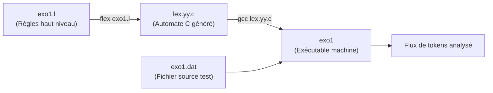

# TP3 : Analyse Lexicale avec FLEX

Ce dossier contient la réalisation du **TP3** sur l'utilisation du générateur d'analyseur lexical **FLEX** (Fast Lexical Analyzer Generator).

---

## 📖 Guide Complet : Comprendre et Utiliser Flex

### 1. Pourquoi utiliser Flex ? (Lien avec TP1 et TP2)

Dans les **TP1** et **TP2**, l'analyseur lexical a été programmé manuellement en C (`tp1.c`) :
- Lecture caractère par caractère (`getchar()`).
- Gestion manuelle des états d'un automate (DFA) avec des `switch(etat)` et `while`.
- Gestion manuelle des retours en arrière et des buffers.

Cette méthode manuelle est longue, complexe et source d'erreurs dès que le langage grandit.

**Flex est un métaprogramme (générateur de code) :**  
Au lieu d'écrire l'automate à la main, on décrit simplement des **expressions régulières** associées à des **actions C**. Flex se charge de construire automatiquement l'automate fini déterministe (DFA) et de générer le code C complet à notre place.

---

### 2. Le rôle du fichier `.c` généré (`lex.yy.c`)

Flex ne lit pas le texte source directement à l'exécution. Son rôle est de traduire vos règles en C :



1. **Vous écrivez** : `exo1.l` (votre spécification lexicale).
2. **Flex produit** : `lex.yy.c` (un fichier C optimisé contenant la table des transitions et la boucle d'analyse).
3. **GCC produit** : `exo1` (le binaire exécutable).
4. **Vous exécutez** : `./exo1 < fichier.dat` pour analyser votre code source.

---

### 3. Structure d'un fichier Flex (`.l`)

Un fichier Flex comporte obligatoirement trois sections séparées par `%%` :

```lex
%{
    /* ----------------------------------------------------
       Section 1 : Déclarations C & Inclusions
       Ce code est copié tel quel au début de lex.yy.c
       ---------------------------------------------------- */
    #include <stdio.h>
%}

/* Définitions de macros régulières (raccourcis) */
CHIFFRE    [0-9]
LETTRE     [a-zA-Z]

%%
    /* ----------------------------------------------------
       Section 2 : Règles de reconnaissance
       Format :  MOTIF_REGEX    { ACTION_C }
       ---------------------------------------------------- */
"for"                   { printf("[MOT_CLE: for] "); }
{LETTRE}+               { printf("[MOT: %s] ", yytext); }
{CHIFFRE}+              { printf("[NOMBRE: %s] ", yytext); }
[ \t\n]+                { /* Ignorer les blancs */ }
.                       { printf("[AUTRE: %s] ", yytext); }

%%
    /* ----------------------------------------------------
       Section 3 : Code C utilisateur
       Fonction main() et fonctions auxiliaires
       ---------------------------------------------------- */
int main(void) {
    yylex(); /* Démarre l'analyse lexicale */
    return 0;
}
```

---

### 4. Variables et Fonctions Clés de Flex

| Nom | Type / Rôle | Rôle |
| :--- | :--- | :--- |
| `yytext` | `char*` | Pointeur vers le texte exact reconnu par la règle courante. |
| `yyleng` | `int` | Longueur du motif reconnu (`strlen(yytext)`). |
| `yylex()` | `int` | Fonction principale du scanner ; lit l'entrée et exécute les actions associées. |
| `yyin` | `FILE*` | Flux d'entrée (`stdin` par défaut, modifiable avec `fopen`). |
| `%option noyywrap` | Directive | Désactive le besoin de fournir une fonction `yywrap()` ou de lier `-lfl`. |
| `%option nounput noinput` | Directive | Supprime les avertissements de fonctions non utilisées générées par défaut. |

---

### 5. Règles de Priorité d'Ambigüité

Lorsque deux règles peuvent correspondre au même texte :
1. **Règle de la plus longue correspondance (Longest Match)** : Si le texte est `format`, Flex choisira la règle de l'identificateur (6 caractères) plutôt que le mot-clé `for` (3 caractères).
2. **Ordre d'apparition (First Rule)** : Si deux règles ont la même longueur (ex: le mot `for` correspond au mot-clé `for` ET à l'identificateur `[a-zA-Z]+`), **la première règle déclarée l'emporte**.  
   👉 **Conséquence :** Les mots-clés doivent toujours être placés **avant** la règle des identificateurs.

---

## 🛠️ Exercice 1 : Reconnaissance des Unités Lexicales

### Objectifs
Reconnaître et étiqueter les éléments d'un langage de programmation :
- **Mots-clés** : `for`, `while`, `if`, `else`, `int`, `float`, `return`.
- **Opérateurs composés** : `++`, `--`, `==`, `!=`, `<=`, `>=`, `&&`, `||`.
- **Opérateurs simples et séparateurs** : `=`, `+`, `-`, `*`, `/`, `<`, `>`, `(`, `)`, `{`, `}`, `[`, `]`, `;`, `,`.
- **Nombres entiers** : suites de chiffres `[0-9]+`.
- **Nombres flottants/réels** : notation décimale et scientifique (ex: `12.3`, `.0`, `45.67e-2`).
- **Identificateurs** : débutant par une lettre, suivie de lettres ou chiffres.

---

### Fichiers de l'Exercice

- **`exo1.l`** : Fichier source Flex complet contenant l'ensemble des règles.
- **`exo1.dat`** : Programme d'exemple testé.
- **`Makefile`** : Automatisation de la compilation et des tests.

---

### Compilation et Exécution

#### Méthode rapide avec le Makefile :
```bash
# Compiler exo1
make

# Compiler et lancer directement le test
make test

# Nettoyer les fichiers compilés
make clean
```

#### Méthode manuelle étape par étape :
```bash
# 1. Génération du fichier C par Flex
flex exo1.l

# 2. Compilation avec GCC
gcc -Wall lex.yy.c -o exo1

# 3. Exécution avec le fichier de test
./exo1 exo1.dat
```

---

### Exemple de Résultat Obtenu

Sur le programme d'entrée [`exo1.dat`](file:///run/media/zakariae-bakkari/linux/Education/Phase1/Compilation/Assignments/compilation-tp/TP3/exo1.dat) :
```c
for( i=0; i < 10; i++ ) {
    truc[i] = 0;
    machin = 12.3;
    bidule = .0;
    valeur = 45.67e-2;
    if (machin >= 10 && bidule != 1.5) {
        return i + 1;
    }
}
```

La sortie produite est :
```text
[MOT_CLE: for] [PAR_OUVR: (] [IDF: i] [AFFECT: =] [NB_ENTIER: 0] [PVIRG: ;] [IDF: i] [OP_LT: <] [NB_ENTIER: 10] [PVIRG: ;] [IDF: i] [OP_INC: ++] [PAR_FERM: )] [ACCO_OUVR: {]
[IDF: truc] [CROCH_OUVR: [] [IDF: i] [CROCH_FERM: ]] [AFFECT: =] [NB_ENTIER: 0] [PVIRG: ;] 
[IDF: machin] [AFFECT: =] [NB_REEL: 12.3] [PVIRG: ;] 
[IDF: bidule] [AFFECT: =] [NB_REEL: .0] [PVIRG: ;] 
[IDF: valeur] [AFFECT: =] [NB_REEL: 45.67e-2] [PVIRG: ;] 
[MOT_CLE: if] [PAR_OUVR: (] [IDF: machin] [OP_GE: >=] [NB_ENTIER: 10] [OP_AND: &&] [IDF: bidule] [OP_NEQ: !=] [NB_REEL: 1.5] [PAR_FERM: )] [ACCO_OUVR: {]
[MOT_CLE: return] [IDF: i] [OP_PLUS: +] [NB_ENTIER: 1] [PVIRG: ;] 
[ACCO_FERM: }]
[ACCO_FERM: }]
```
